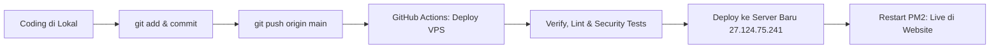

# Panduan Lengkap Clone & Update Kodingan Terbaru (GitHub & VPS)

Panduan ini berisi langkah-langkah lengkap untuk mengunduh (_clone_) kode sumber terbaru dari GitHub, memperbarui (_pull/update_) repositori yang sudah ada, menjalankan aplikasi di lokal, hingga alur _push_ otomatis ke VPS produksi.

---

## 📌 Informasi Repositori

- **URL GitHub**: [https://github.com/Rudin1409/gis-infrastructure-mapping-system](https://github.com/Rudin1409/gis-infrastructure-mapping-system)
- **URL Clone HTTPS**: `https://github.com/Rudin1409/gis-infrastructure-mapping-system.git`
- **URL Clone SSH**: `git@github.com:Rudin1409/gis-infrastructure-mapping-system.git`
- **Branch Utama**: `main`
- **Server Produksi**: `https://rumija.lubuklinggaukota.go.id/` (Server Baru: `27.124.75.241`)

---

## 1. Cara Clone Baru (Untuk Komputer/Laptop Baru)

Jika Anda baru pertama kali mengunduh proyek ini di komputer atau server baru:

### Langkah 1: Clone Repository

Buka Terminal / PowerShell / Git Bash, lalu jalankan:

```bash
# Clone menggunakan HTTPS
git clone https://github.com/Rudin1409/gis-infrastructure-mapping-system.git

# Masuk ke direktori proyek
cd gis-infrastructure-mapping-system
```

### Langkah 2: Pastikan Node.js Terpasang

Aplikasi ini membutuhkan **Node.js versi 20.x atau 22.x (LTS)**. Periksa versi Anda:

```bash
node -v
npm -v
```

### Langkah 3: Install Dependensi

```bash
npm install
```

_(Atau gunakan `npm ci` jika ingin mengunci versi sesuai `package-lock.json`)_.

### Langkah 4: Setup Environment (`.env.local`)

Salin file template environment ke `.env.local`:

```bash
# Di Linux/macOS/Git Bash:
cp .env.local.example .env.local

# Di Windows PowerShell:
Copy-Item .env.local.example .env.local
```

Buka `.env.local` dan sesuaikan nilainya:

- `DATABASE_URL`: URL PostgreSQL (jika menggunakan database lokal/VPS).
- `SUPABASE_URL` & `SUPABASE_SERVICE_ROLE_KEY`: Kunci Supabase jika fallback ke cloud.
- `NEXT_PUBLIC_GOOGLE_MAPS_API_KEY`: API Key untuk peta dan geocoding.
- `MASTER_SECURITY_PIN`: PIN Master untuk otorisasi Menu Khusus Admin.

### Langkah 5: Jalankan di Lokal (Development)

```bash
npm run dev
```

Buka browser di [http://localhost:3000](http://localhost:3000).

---

## 2. Cara Update ke Kodingan Paling Baru (Jika Sudah Pernah Clone)

Jika Anda sudah memiliki folder proyek di komputer Anda dan ingin mengambil semua pembaruan kodingan terbaru dari GitHub:

### Langkah 1: Cek Status Branch & Perubahan Lokal

Pastikan tidak ada file yang sedang konflik atau perubahan kotor yang belum disimpan:

```bash
git status
```

> [!TIP]
> Jika ada perubahan lokal yang ingin Anda simpan sementara sebelum mengambil versi terbaru dari GitHub, jalankan:
>
> ```bash
> git stash
> ```

### Langkah 2: Ambil dan Terapkan Update dari GitHub

Jalankan perintah berikut secara berurutan:

```bash
# 1. Ambil info branch terbaru dari GitHub
git fetch origin

# 2. Pastikan berada di branch main
git checkout main

# 3. Tarik (pull) seluruh kodingan terbaru
git pull origin main
```

### Langkah 3: Update Library/Dependensi

Jika ada penambahan library baru di commit terbaru, perbarui `node_modules`:

```bash
npm install
```

### Langkah 4: Verifikasi Integritas Kode

Jalankan pengecekan tipe dan format kode:

```bash
# Cek format (Prettier) dan tipe (TypeScript)
npm run check

# Cek suite keamanan (13 security tests)
npm run test:security
```

### Langkah 5: Tes Build Produksi Lokal (Opsional)

Untuk memastikan aplikasi siap rilis tanpa error build:

```bash
npm run build
```

---

## 3. Cara Mengembalikan File Lokal Jika Terjadi Konflik (Reset Bersih)

Jika saat melakukan `git pull` muncul pesan error konflik (misalnya karena perubahan lokal yang tidak dibutuhkan):

```bash
# PERINGATAN: Perintah ini akan menghapus perubahan lokal yang belum di-commit
# dan menyamakan persis dengan repositori GitHub:

git fetch origin
git checkout main
git reset --hard origin/main
git clean -fd
npm install
```

---

## 4. Alur Kerja Push & Auto-Deploy ke VPS Produksi

Repository ini telah dilengkapi dengan pipeline otomatis (**CI/CD via GitHub Actions**):



### Langkah Kirim Update dari Komputer Anda ke GitHub:

1. Periksa perubahan file:

   ```bash
   git status
   ```

2. Tambahkan file yang diubah:

   ```bash
   git add .
   ```

3. Buat commit dengan pesan yang jelas:

   ```bash
   git commit -m "feat: deskripsi perubahan yang Anda buat"
   ```

4. Push ke GitHub:

   ```bash
   git push origin main
   ```

5. **Pantau Proses Deploy**:
   - Buka tab **Actions** di GitHub: [GitHub Actions Workflow](https://github.com/Rudin1409/gis-infrastructure-mapping-system/actions)
   - Workflow `Deploy VPS` akan otomatis memverifikasi kode, mengemas rilis, mengunggah ke Server Baru, dan me-restart layanan `gis-app` di PM2.
   - Hasil rilis langsung aktif di [https://rumija.lubuklinggaukota.go.id/](https://rumija.lubuklinggaukota.go.id/).

---

## 5. Ringkasan Perintah Penting (Cheat Sheet)

| Kebutuhan                        | Perintah                                                                       |
| :------------------------------- | :----------------------------------------------------------------------------- |
| **Clone pertama kali**           | `git clone https://github.com/Rudin1409/gis-infrastructure-mapping-system.git` |
| **Update kodingan terbaru**      | `git pull origin main`                                                         |
| **Install dependensi**           | `npm install`                                                                  |
| **Jalankan dev server**          | `npm run dev`                                                                  |
| **Cek formatting & types**       | `npm run check`                                                                |
| **Cek uji keamanan**             | `npm run test:security`                                                        |
| **Build aplikasi**               | `npm run build`                                                                |
| **Simpan perubahan sementara**   | `git stash`                                                                    |
| **Keluarkan simpanan sementara** | `git stash pop`                                                                |
| **Reset total ke GitHub**        | `git reset --hard origin/main`                                                 |
| **Push update ke GitHub/VPS**    | `git push origin main`                                                         |
